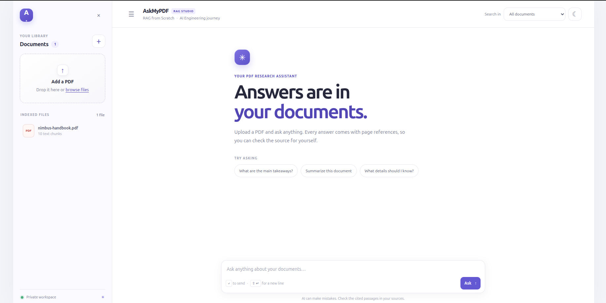

# AskMyPDF: RAG from Scratch

AskMyPDF is a small PDF question-answering app built of my AI Engineering journey. It extracts PDF text, splits it into overlapping chunks, creates local sentence embeddings, retrieves relevant passages, and asks Gemini to answer with citations back to those passages. The Express server serves the browser app and the upload, search, and document-management API.

## Run locally

1. Install dependencies with `npm install`.
2. Add a Gemini API key to `.env`:

   ```env
   GEMINI_API_KEY=your_api_key
   # Optional: GEMINI_MODEL=your-supported-model
   ```

3. Start the server with `npm run dev`.
4. Open [http://localhost:3005](http://localhost:3005), upload a searchable PDF, and ask a question.

The first embedding run may download the model files. Scanned PDFs need OCR before their text can be indexed. The index is stored locally under `data/`.

## Screenshot



## RAG pipeline

```text
PDF upload
   ↓
Text extraction by page
   ↓
Overlapping text chunks
   ↓
Local sentence embeddings ──────────────┐
   ↓                                     │
Persist chunks and vectors               │
                                         │
Question → question embedding → cosine similarity search
                                         ↓
                           Top matching passages + page metadata
                                         ↓
                         Gemini answer with [1], [2] citations
                                         ↓
                         UI answer, badges, and source cards
```
